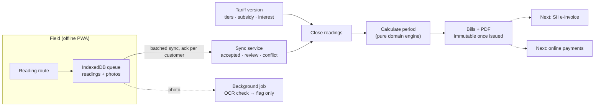

# APR — Billing Platform for Rural Water Utilities

**A multi-tenant SaaS that runs the monthly billing cycle for Chile's rural drinking-water committees — from offline meter readings in the field to legally compliant bills.**

[Marco Alvarado](https://github.com/7pixel-cl) · [Portfolio](https://7pixel.cl) · [LinkedIn](https://www.linkedin.com/in/marcoalvaradot/)

**[Read the full case study online →](https://7pixel-cl.github.io/apr-showcase/)**

> Production source is private. This repository is a public case study — no code, customer data, or infrastructure details.

## At a glance

| | |
| --- | --- |
| **Role** | Product owner & sole engineer — domain research, architecture, implementation, deployment |
| **Users** | Treasurers, committee presidents, meter readers, and auditors of rural water operators (≤ 300 connections) |
| **Status** | Billing core (phases 0–1) complete and deployed behind a gated CI/CD pipeline. Electronic invoicing (SII) and online payments are the next phases |
| **Scale of the codebase** | ~20k lines of TypeScript · 23 tables · ~240 automated tests (unit, real-Postgres RLS, offline E2E) |

## The problem

Chile has roughly 2,400 rural drinking-water operators (APR/SSR), serving ~2.4 million people and run largely by volunteer committees. Under Law 20.998 they must bill each household monthly using tiered tariffs, subsidies, late interest, and specific notices — often with paper notebooks, spreadsheets, and meter readers walking routes with **no mobile signal**.

Off-the-shelf billing software assumes reliable connectivity, an accountant on staff, and a single company. These operators need the opposite: something a volunteer treasurer can run, that works offline in the field, and that gets the legal rules right every time.

## What I built

- **Customer register import** — a CSV wizard that validates and imports the existing household list, with per-row error reporting.
- **Versioned tariffs** — consumption tiers (marginal or total, configurable per operator), fixed charges, subsidies, and interest, versioned so past bills are always reproducible.
- **Offline field app (PWA)** — meter readers install the app, download their route, and capture readings and meter photos with no connectivity; everything syncs when signal returns.
- **Idempotent billing run** — closes readings, calculates the period, and generates bill PDFs with the regulator's mandatory content. Re-running a period is safe and never touches issued bills.
- **Anomaly detection** — implausible consumption is flagged, and a background job runs OCR on meter photos to flag mismatches against the typed reading.
- **Team & roles** — six committee roles with invitations, passkeys, and email-code login.

## How the monthly cycle works

## Engineering highlights

### 1. Fail-closed multi-tenancy with Postgres row-level security
Every operator's data lives in the same database, isolated by **forced RLS**. A helper opens each transaction with the tenant set at the database level, and repositories only accept a *branded* `TenantTx` type — so code that forgets the tenant **doesn't compile**, and a query that slips through returns nothing rather than another committee's data. Cross-tenant tests run against a real Postgres in CI.

### 2. A pure, law-traceable domain engine
Consumption, tariff, subsidy, interest, and collections rules live in a package with **no I/O**, covered by table-driven tests. Each rule references the legal source it implements, which makes audits and regulator questions answerable from the code.

### 3. Offline-first sync that never loses a reading
Field captures go into an IndexedDB queue and sync in batches. A capture only changes state when the server acknowledges that specific customer, and the server classifies each one as *accepted*, *needs review*, or *conflict* — so flaky rural connectivity can't silently drop or duplicate a reading. A Playwright test exercises the offline flow against the production build.

### 4. Immutability enforced by the database, not by convention
Issued bills and the audit log are protected by **Postgres triggers** (the audit log is written by a `SECURITY DEFINER` trigger). Even a bug in the application can't rewrite financial history.

### 5. AI assists, humans decide
OCR on meter photos can **only raise a flag** — it never changes a reading. That keeps the system explainable to a committee and a regulator.

### 6. A deploy pipeline that has to earn production
CI runs lint/format (Biome), typecheck, schema drift checks, unit tests, RLS tests on real Postgres, and the offline E2E test. **Only if all pass** does it migrate the production database and trigger the deploy. Auto-deploy and direct pushes to `main` are deliberately disabled.

## Stack

Next.js 16 · React 19 · TypeScript · tRPC 11 · Drizzle ORM · PostgreSQL 17 (Neon) with RLS · Better Auth (organizations, passkeys) · Inngest · Serwist + Dexie (PWA / IndexedDB) · tesseract.js · pdfkit · Vitest · Playwright · Biome · Turborepo + pnpm · Vercel

## What I learned

Domain research was as much of the work as code: reading the law and regulator manuals first, writing the rules as pure functions, and only then building screens. For a small, non-technical customer base, **correctness and recoverability** (idempotent runs, immutable bills, offline queues) matter far more than feature count.

---

© 2026 Marco Alvarado. All rights reserved. This showcase does not license the production software.
